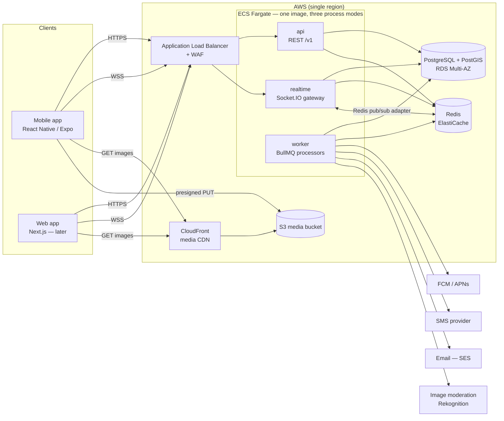
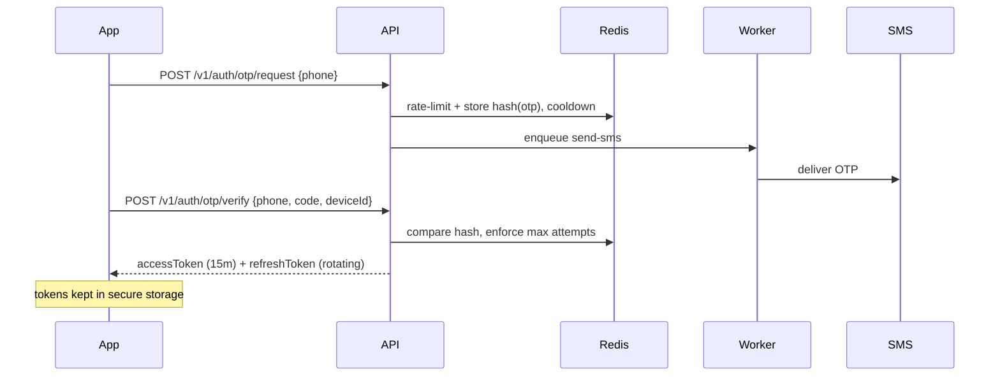
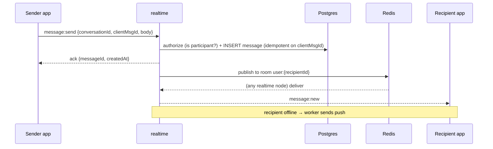

# 01 — System Design

Status: Draft v0.1. Decisions referenced as ADRs. Numbers are **planning assumptions**, not measurements.

## 1. Context



**One codebase, three process modes.** `api`, `realtime` and `worker` are separate entry points built into the same Docker image and deployed as separate ECS services so they scale independently. (Early on, `api` + `realtime` may share a service — see §7.)

## 2. Key flows

### 2.1 Sign-in (phone OTP — see ADR-0006)


### 2.2 Swipe → match
```mermaid
sequenceDiagram
  participant App
  participant API
  participant PG as Postgres
  participant Redis
  participant Worker
  App->>API: POST /v1/swipes {targetId, direction, requestId}
  API->>PG: BEGIN; INSERT swipe (idempotent on swiper,target)
  alt direction=like and reverse like exists
    API->>PG: INSERT match + conversation
    API->>Redis: publish match event
  end
  API->>PG: COMMIT
  API->>Redis: add target to seen-set
  API-->>App: {matched: bool, matchId?}
  Redis-->>Worker: match event → push notification to both users
```

### 2.3 Send message


### 2.4 Photo upload
1. App → `POST /v1/media/photos` (metadata) → API returns a **presigned S3 PUT URL** and `photoId`.
2. App uploads directly to S3 (API never handles image bytes).
3. S3 event → worker: validate type/size, strip EXIF/GPS, generate sizes, run moderation.
4. Photo status `pending → approved | rejected`; only `approved` photos are served in discovery.

## 3. Component responsibilities

| Component | Owns | Never does |
|---|---|---|
| `api` | REST endpoints, validation, authz, transactions | Long-running work, image processing |
| `realtime` | Socket auth, rooms, message send/ack, typing, presence | Business rules beyond chat authz |
| `worker` | Email/SMS/push, moderation, discovery queue refills, cleanup jobs | Serving user requests |
| Postgres | Source of truth for all durable state | Ephemeral state (OTP, presence, rate limits) |
| Redis | Rate limits, OTP, presence, discovery queues, BullMQ, socket adapter | Being the only copy of anything we cannot rebuild |
| S3 + CloudFront | Photo storage and delivery | — |

**Rule:** Redis can be flushed without data loss that matters (users re-login at worst; queues rebuild). Anything that cannot be rebuilt lives in Postgres.

## 4. Scale assumptions — `Assumed`

Back-of-envelope for a plausible growth path (illustrative arithmetic, to be replaced by real metrics):

| Metric | 10k MAU | 100k MAU | 1M MAU |
|---|---|---|---|
| DAU (≈20% of MAU) | 2k | 20k | 200k |
| Swipes/day (≈50 per DAU) | 100k | 1M | 10M |
| Swipes/sec (avg) | ~1 | ~12 | ~116 |
| Swipes/sec (peak ≈ 4× avg) | ~5 | ~50 | ~460 |
| Peak concurrent sockets (≈10% of DAU) | ~200 | ~2k | ~20k |
| Messages/day (≈30 per DAU) | 60k | 600k | 6M |

Takeaway: through ~100k MAU a single well-indexed Postgres primary, one Redis, and a handful of small containers is enough. The plan is to **not** build for 1M MAU on day one, while keeping the seams that let us get there.

## 5. Scaling stages

| Stage | Trigger (any) | Changes |
|---|---|---|
| **S0 — Launch** (≤ ~50k MAU) | — | Single region, RDS Multi-AZ small, Redis small, `api`(+`realtime`) ×2, `worker` ×1. Pooler (RDS Proxy / PgBouncer). |
| **S1 — Growth** (~50k–500k) | DB CPU > 60% sustained, p95 latency drift, queue depth growing | Autoscale services; RDS read replica for discovery/read-heavy queries; split `realtime` into its own service; tune/partition `swipes` and `messages`; CloudFront image resizing; moderation queue tooling |
| **S2 — Scale** (500k+) | Primary write saturation, hot partitions | Shard-ready keys (already UUIDv7), move chat to dedicated store *if metrics demand*, extract services along module seams, consider multi-region read paths |

Each step is triggered by **observed metrics** (see [infra & operations](08-infra-and-operations.md)), not by calendar.

## 5.1 Seams that keep scaling cheap

- Modules never read each other's tables — only call each other's services ([architecture](02-architecture.md)). A module can be extracted to its own service later.
- IDs are UUIDv7 (time-ordered, shard-friendly, no central sequence).
- All cross-module side effects go through domain events → queues, so they can become async/remote.
- Discovery and chat have their own stores' **interfaces** (repository layer) so storage can change without touching business logic.
- Cursor pagination everywhere (no offset).

## 6. Failure modes & mitigations

| Failure | Impact | Mitigation |
|---|---|---|
| Redis down | No OTP, rate-limit, discovery queue, realtime fan-out | Managed Multi-AZ; API fails closed on auth-sensitive paths, degrades discovery to direct Postgres query; Socket clients reconnect with backoff |
| Postgres failover | ~1–2 min write unavailability | Multi-AZ, client retries with jittered backoff, idempotent writes |
| Realtime node dies | Sockets drop | Client auto-reconnect; missed messages recovered by `GET /conversations/:id/messages?after=` on reconnect |
| SMS provider outage | Cannot log in new sessions | Secondary provider behind an interface; email-OTP fallback |
| Worker backlog | Late push/moderation | BullMQ retries + DLQ, queue-depth alarm, photos stay `pending` (safe default) |
| Bad deploy | Errors | Rolling deploy with health checks and automatic rollback; migrations are expand/contract ([CI/CD](07-cicd.md)) |
| Abuse / scraping | Cost, safety | Per-user + per-IP rate limits, swipe quotas, WAF, device attestation later |

## 7. Early-stage simplifications (deliberate)

- `api` and `realtime` may run in one ECS service at launch (same image, both modes enabled). Split when sockets or CPU profile diverge.
- One environment-wide Redis instance, logical key prefixes.
- No search cluster: filtering is SQL + PostGIS.
- No feature-flag service: env-based flags in a typed config module.
- No separate analytics pipeline: product analytics via the client SDK; operational metrics via CloudWatch.

## 8. Cross-cutting

- Security & privacy: [05](05-auth-and-security.md)
- Observability & operations: [08](08-infra-and-operations.md)
- Data model: [03](03-data-model.md)
