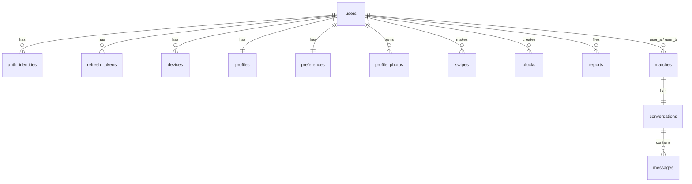

# 03 — Data Model

Status: Draft v0.1 · Postgres 16+ with **PostGIS** · ORM: Drizzle ([ADR-0005](adr/0005-drizzle-orm.md))

This is the **planned** schema, not final DDL. Exact column types/constraints are settled in the migration PRs. Conventions: `snake_case`, plural tables, UUIDv7 PKs, `timestamptz`, soft-delete only where stated.

## 1. Entity overview

## 2. Tables

### Identity & account
| Table | Key columns | Notes |
|---|---|---|
| `users` | `id`, `status` (`pending\|active\|paused\|suspended\|deleted`), `created_at`, `last_active_at`, `deleted_at` | Thin. Anything profile-ish lives in `profiles`. |
| `auth_identities` | `id`, `user_id`, `provider` (`phone\|email\|apple\|google`), `subject`, `verified_at` | `UNIQUE(provider, subject)`. Phone stored E.164; consider hashing/encrypting at rest. One user can have several identities. |
| `refresh_tokens` | `id`, `user_id`, `family_id`, `token_hash`, `device_id`, `expires_at`, `revoked_at`, `replaced_by` | Rotating; reuse of a revoked token revokes the whole `family_id` ([auth](05-auth-and-security.md)). Store **hash only**. |
| `devices` | `id`, `user_id`, `platform`, `push_token`, `app_version`, `last_seen_at` | Push token upsert on app start; pruned on FCM `UNREGISTERED`. |

### Profile & preferences
| Table | Key columns | Notes |
|---|---|---|
| `profiles` | `user_id` PK/FK, `display_name`, `birth_date`, `gender`, `bio`, `location geography(Point,4326)`, `location_updated_at`, `city`, `country`, `onboarding_completed_at`, `visibility`, `verification_status` | **Age is computed** from `birth_date`; enforce ≥ 18 in DB check + service. Exact coordinates are never returned to other users — only a bucketed distance. |
| `preferences` | `user_id` PK/FK, `min_age`, `max_age`, `max_distance_km`, `interested_in gender[]` | Defaults on onboarding. |
| `profile_photos` | `id`, `user_id`, `storage_key`, `position`, `moderation_status` (`pending\|approved\|rejected`), `width`, `height`, `created_at` | `UNIQUE(user_id, position)`. Only `approved` served in discovery. |

### Engagement
| Table | Key columns | Notes |
|---|---|---|
| `swipes` | `id`, `swiper_id`, `target_id`, `direction` (`like\|pass`), `created_at` | `UNIQUE(swiper_id, target_id)` (idempotent). Grows fastest → **hash-partition by `swiper_id`** when needed (plan the PK to include it). |
| `matches` | `id`, `user_a`, `user_b`, `created_at`, `unmatched_at`, `unmatched_by` | Store ordered pair (`user_a < user_b`) with `UNIQUE(user_a, user_b)` and `CHECK(user_a < user_b)` so a pair can't be duplicated in reverse. |
| `conversations` | `id`, `match_id` UNIQUE, `last_message_at`, `last_message_id` | 1:1 with a match. |
| `messages` | `id` (UUIDv7), `conversation_id`, `sender_id`, `type`, `body`, `client_msg_id`, `created_at`, `read_at` | `UNIQUE(conversation_id, client_msg_id)` for idempotent send. **Range-partition by month on `created_at`** (PK must include partition key — settle when implementing). Index `(conversation_id, id DESC)`. |

### Safety & ops
| Table | Key columns | Notes |
|---|---|---|
| `blocks` | `blocker_id`, `blocked_id`, `created_at` | PK `(blocker_id, blocked_id)`. Block is **symmetric in effect**: neither user sees the other in discovery, existing match/conversation is closed. |
| `reports` | `id`, `reporter_id`, `reported_id`, `reason`, `details`, `status`, `created_at`, `resolved_by`, `resolved_at` | Triage via SQL/internal script in v1. |
| `audit_log` | `id`, `actor`, `action`, `subject`, `meta jsonb`, `created_at` | Moderation actions, account suspensions, data exports/deletions. |

## 3. Indexes (initial)

| Table | Index | Why |
|---|---|---|
| `profiles` | `GIST(location)` | radius queries (`ST_DWithin`) |
| `profiles` | partial BTREE on `(gender, birth_date)` `WHERE visibility='visible' AND onboarding_completed_at IS NOT NULL` | candidate filtering |
| `swipes` | `UNIQUE(swiper_id, target_id)`; `(target_id, swiper_id) WHERE direction='like'` | idempotency; reverse-like lookup for match detection |
| `matches` | `(user_a)`, `(user_b)` | "my matches" |
| `messages` | `(conversation_id, id DESC)` | history pagination |
| `auth_identities` | `UNIQUE(provider, subject)` | login lookup |
| `refresh_tokens` | `(token_hash)`, `(family_id)` | rotation / reuse detection |

Rule: every index is justified by a named query. Review with `EXPLAIN (ANALYZE, BUFFERS)` before merging new heavy queries.

## 4. Location handling

- Store as `geography(Point, 4326)`; query with `ST_DWithin(location, :me, :meters)` and order by `ST_Distance` (KNN `<->` for ordering where applicable).
- **Privacy:** clients receive distance rounded (e.g. "2 km away", min bucket 1 km), never coordinates. Location updates are throttled (movement > ~500 m or > 1 h).
- Users may hide distance; honour in serializers.

## 5. Migrations

- Tool: `drizzle-kit generate` → SQL files committed in `drizzle/`; applied by a one-off migration task before app rollout ([CI/CD](07-cicd.md)).
- **Expand → migrate → contract**: never drop/rename a column in the same release that stops using it. Two releases minimum.
- PostGIS and `pgcrypto`/`uuid-ossp` enabled via a baseline migration; local `docker/` init SQL mirrors it.
- Large backfills run as worker jobs in batches, never inside a migration transaction.

## 6. Redis keyspace

All keys prefixed `flinger:{env}:` (omitted below). TTLs are mandatory except where noted.

| Key | Type | TTL | Purpose |
|---|---|---|---|
| `otp:{identityHash}` | string (hash of code) | 10 min | OTP verification |
| `otp:cooldown:{identityHash}` | string | 120 s | resend cooldown |
| `otp:attempts:{identityHash}` | counter | 10 min | max-attempt lockout |
| `rl:{route}:{userId\|ip}` | counter | window | rate limits |
| `disc:deck:{userId}` | list of candidate ids | 24 h | precomputed deck |
| `disc:seen:{userId}` | set (or bloom) of ids already swiped/blocked/matched | none (rebuildable) | exclusion |
| `swipe:quota:{userId}:{yyyymmdd}` | counter | 36 h | daily like limit |
| `presence:{userId}` | string | 60 s, refreshed | online state |
| `sock:user:{userId}` | Socket.IO room | n/a | fan-out target |
| BullMQ keys | managed | n/a | jobs |

`disc:seen` is a **cache of Postgres truth**: rebuilt from `swipes` + `blocks` + `matches` on miss.

## 7. Data lifecycle & compliance

| Event | Behaviour |
|---|---|
| Account pause | `users.status='paused'`; removed from all decks; chats remain |
| Account delete | Immediate: status `deleted`, tokens revoked, profile hidden. Within 30 days (worker): purge photos from S3, anonymize messages sent (`sender_id` kept for the counterpart's history but content replaced per policy), delete identities. Keep minimal `audit_log` for legal/safety. |
| Data export | On request: async job produces a JSON bundle (profile, matches, messages sent) delivered via a signed URL |
| Backups | Automated daily + PITR; retention 7 days (staging) / 14–35 days (prod); backups contain deleted data until they expire — document in privacy policy |
