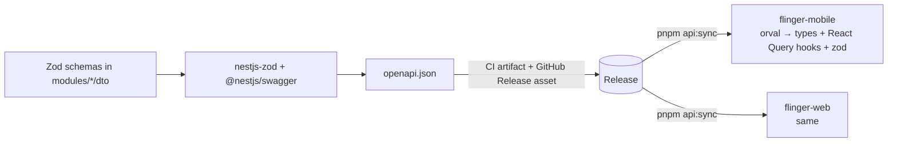

# 04 — API & Contracts

Status: Draft v0.1 · Related: [ADR-0001](adr/0001-separate-repos-openapi-contract.md)

The API is consumed by independently released clients (mobile now, web later). **The generated OpenAPI document is the contract.** There is no shared code package between repos.

## 1. Conventions

| Topic | Rule |
|---|---|
| Base path | `/v1/...` (URI versioning). A new major version only for breaking changes; run both for the overlap window. |
| Style | JSON over HTTPS. Resource-oriented. `camelCase` JSON fields. |
| Auth | `Authorization: Bearer <accessToken>`; public routes explicitly marked `@Public()` |
| Pagination | Cursor: `?cursor=<opaque>&limit=<1..50>` → `{ items: [], nextCursor: string\|null }` |
| Timestamps | ISO-8601 UTC strings |
| IDs | UUID strings |
| Idempotency | `requestId` (body) / `Idempotency-Key` (header) on retryable mutations |
| Rate limits | `429` with `Retry-After`; headers `RateLimit-*` |
| Client identity | `X-App-Version`, `X-Platform`, `X-Device-Id` sent by the app on every request |

### Standard error body (RFC 7807)

```json
{
  "type": "https://api.flinger.app/errors/otp-invalid",
  "title": "Invalid code",
  "status": 400,
  "code": "OTP_INVALID",
  "detail": "The code you entered is incorrect.",
  "requestId": "01J...",
  "errors": [{ "path": "code", "message": "Must be 6 digits" }]
}
```

- Clients switch on **`code`**, never on `detail`/`title` text.
- Error `code`s are part of the contract and listed in the OpenAPI document.

## 2. Initial endpoint map (v1, subject to refinement)

| Area | Endpoints |
|---|---|
| Auth | `POST /auth/otp/request`, `POST /auth/otp/verify`, `POST /auth/refresh`, `POST /auth/logout`, `POST /auth/social/apple` · `/google` |
| Me | `GET /me`, `PATCH /me/profile`, `PATCH /me/preferences`, `PUT /me/location`, `POST /me/pause`, `DELETE /me` |
| Media | `POST /me/photos` (→ presigned URL), `PATCH /me/photos/order`, `DELETE /me/photos/:id` |
| Discovery | `GET /discovery/deck?limit=` |
| Swipes | `POST /swipes` |
| Matches | `GET /matches`, `DELETE /matches/:id` (unmatch) |
| Chat | `GET /conversations`, `GET /conversations/:id/messages?cursor=`, `POST /conversations/:id/read` (messages themselves travel over the socket; a REST fallback `POST /conversations/:id/messages` exists) |
| Notifications | `PUT /devices/:id/push-token` |
| Safety | `POST /blocks`, `DELETE /blocks/:userId`, `POST /reports` |
| Meta | `GET /health`, `GET /ready`, `GET /v1/config` (min app version, feature flags) |

Socket events (Socket.IO, namespace `/chat`): `message:send` / `message:new`, `message:ack`, `typing`, `read`, `presence`. Payload schemas are Zod-defined and documented alongside OpenAPI (AsyncAPI-style table in the repo when implemented).

## 3. Versioning & compatibility rules

Mobile clients in the wild cannot be force-updated instantly. Therefore:

1. **Additive changes only** within `/v1`: new optional fields, new endpoints, new enum values (clients must treat unknown enums safely).
2. **Never** remove/rename/retype a field or tighten validation within a version.
3. CI runs **`oasdiff`** of the PR's spec vs `main`'s; breaking changes fail the build unless the PR is explicitly labeled `breaking-change` and bumps the version path.
4. Minimum supported app version is enforced server-side: if `X-App-Version` < `minSupportedVersion` from `/v1/config`, the API responds `426` with `code: APP_UPDATE_REQUIRED`; the app shows a blocking "Update required" screen.
5. Deprecations are announced in the spec (`deprecated: true`) and logged with usage counts before removal.

## 4. OpenAPI → client codegen



- The backend CI job `build-openapi` writes `openapi.json` and attaches it to every GitHub Release (and to staging deploys as an artifact).
- Clients pin the spec version they were generated from (`api/openapi.lock` records the release tag) and run `pnpm api:sync` to update. Their CI regenerates and fails if the committed client differs (drift check).
- Hand-written API calls in clients are **not allowed** for endpoints in the spec.

## 5. Webhooks / external callbacks

None in v1. (Future: payment provider, SMS delivery receipts.) Any inbound webhook endpoint must verify signatures and be idempotent.
