# 07 — CI/CD (Backend)

Status: Draft v0.1 · Tooling: GitHub Actions → Amazon ECR → ECS Fargate · Related: [infra](08-infra-and-operations.md)

## 1. Principles

1. **Trunk-based.** `main` is always deployable. Short-lived branches, small PRs.
2. **Build once, promote the artifact.** The Docker image built from a commit is the *same digest* that reaches staging and then prod. No rebuilds per environment.
3. **No long-lived cloud keys.** GitHub Actions assumes AWS roles via **OIDC**.
4. **Migrations are separate from rollout** and backward-compatible (expand/contract).
5. **Everything a human would check is automated**; humans approve only the prod promotion.

## 2. Environments

| Env | Purpose | Deploys | Data |
|---|---|---|---|
| `local` | Dev laptop | `docker compose` | Seeded fake data |
| `staging` | Integration + mobile QA | Auto on merge to `main` | Synthetic; never real user data |
| `prod` | Users | Manual approval of a tag/release | Real |

(An ephemeral per-PR preview env is **out of scope** for v1 — revisit if PR review needs it.)

## 3. Pipelines

### 3.1 `pr.yml` — on every pull request

```mermaid
flowchart LR
  A[checkout + pnpm cache] --> B[lint + format check]
  A --> C[typecheck]
  A --> D[unit tests]
  A --> E[integration + e2e<br/>Postgres+PostGIS & Redis service containers]
  A --> F[migration check]
  A --> G[openapi build + oasdiff vs main]
  A --> H[docker build — no push]
  A --> I[security: gitleaks, pnpm audit, CodeQL]
  B & C & D & E & F & G & H & I --> J{all green?}
  J --> K[PR mergeable]
```



| Job | What it enforces |
|---|---|
| `lint` | ESLint (incl. module-boundary rule), Prettier |
| `typecheck` | `tsc --noEmit` strict |
| `unit` | Jest, coverage reported (no hard % gate; reviewers watch deltas on changed files) |
| `integration` | Real Postgres(+PostGIS)/Redis; includes the **swipe-race** and auth tests |
| `migration-check` | (1) `drizzle-kit generate` produces **no diff** (schema and migrations agree); (2) all migrations apply cleanly to an empty DB; (3) destructive statements (`DROP`, `RENAME`) fail the job unless the PR has the `schema-contract` label |
| `openapi` | Generate `openapi.json`, run `oasdiff breaking` against `main`; breaking → fail unless labeled |
| `docker` | Build the image (cache from registry), run container smoke (`/health`) |
| `security` | `gitleaks`, `pnpm audit --prod` (high+), CodeQL (JS/TS) |

Branch protection on `main`: required checks above, 1 approving review (self-review allowed while solo — keep the PR trail), linear history, no force pushes.

### 3.2 `main.yml` — on merge to `main` → staging

1. Re-run the PR checks' essentials (fast path).
2. Build image, tag `sha-<gitsha>` and `main`, **push to ECR** (scan on push).
3. Generate `openapi.json`; upload as workflow artifact.
4. `deploy-staging` (GitHub Environment `staging`):
   - Run **migrations** as a one-off ECS task with the new image (migration DB role).
   - Update the three ECS services (`api`, `realtime`, `worker`) to the new task definitions — rolling deploy with health checks and `deployment circuit breaker` (auto-rollback).
   - Run **smoke tests** (health, auth against a test account, one swipe, one socket round-trip).
5. Notify (Slack/email) on failure.

### 3.3 `release.yml` — on tag `v*` (or manual dispatch) → prod

1. Resolve the image digest already built for that commit (**no rebuild**).
2. **Manual approval** via GitHub Environment `prod` protection rules.
3. Run migrations (one-off task) → deploy services (rolling, circuit breaker) → smoke tests.
4. Create the GitHub Release: changelog + attached `openapi.json` (clients consume this — see [API doc](04-api-and-contracts.md)).
5. Post-deploy: tag Sentry release, mark deploy in CloudWatch/Grafana.

### 3.4 Scheduled / housekeeping
- Dependabot weekly (npm, Docker, GitHub Actions); auto-merge patch bumps when green.
- Nightly: full integration suite + `pnpm audit` + restore-check of latest staging DB snapshot (monthly for prod).

## 4. Docker

- Multi-stage `Dockerfile`: `deps` → `build` → `runtime` (distroless/alpine, non-root, `NODE_ENV=production`, only prod deps + `dist/`).
- One image, mode selected by `APP_MODE=api|realtime|worker`.
- `docker-compose.yml` for local: `postgres` (postgis image), `redis`, `mailpit`, optional `api`/`worker` with hot reload. `docker compose up` is the only prerequisite besides Node + pnpm.
- Image scanning in ECR; base image digest pinned and bumped by Dependabot.

## 5. Database migration strategy (expand → migrate → contract)

| Step | Release N | Release N+1 | Release N+2 |
|---|---|---|---|
| Add column | Add nullable column; code writes both | Backfill (worker job), code reads new | Make NOT NULL / drop old column |
| Rename | Add new, dual-write | Switch reads | Drop old |
| Drop | Stop using column (deploy) | — | Drop column |

- Rollback of an app deploy never requires rolling back the schema (old code still works against the expanded schema).
- Migration role differs from the runtime role (principle of least privilege).
- A migration that can lock a hot table for long (`CREATE INDEX` on `swipes`/`messages`) uses `CONCURRENTLY` and runs outside a transaction.

## 6. Rollback & incident response

| Situation | Action |
|---|---|
| Bad deploy detected by smoke/alarms | ECS circuit breaker rolls back automatically; otherwise re-run `release.yml` with the previous tag |
| Bad migration | Forward-fix (expand/contract makes the previous app version compatible); PITR restore only for data corruption |
| Secret leak | Rotate in Secrets Manager → force new deployment; revoke refresh-token families if tokens affected |
| Feature misbehaving | Disable via config flag (env-based) → redeploy; no code revert needed |

## 7. Secrets & config in CI/CD

- App secrets: AWS Secrets Manager/SSM, referenced in the ECS task definition (not stored in GitHub).
- GitHub stores only non-secret config and the role ARN for OIDC (per-environment).
- `.env.example` is the documented list of variables; Zod config validation fails fast on missing/invalid values.

## 8. Metrics we track for the pipeline itself

PR check duration (target < 8 min), deploy frequency, change-failure rate, time-to-restore. Reviewed at each roadmap phase boundary.

## 9. Planned files

```
.github/
├── workflows/{pr,main,release,nightly}.yml
├── dependabot.yml
├── CODEOWNERS
└── pull_request_template.md
```
Created in roadmap **phase 1**.
