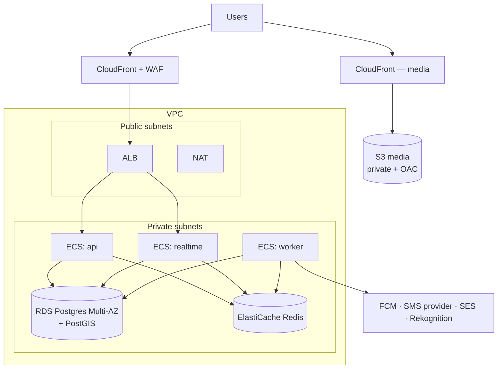

# 08 — Infrastructure & Operations

Status: Draft v0.1 · Cloud: **AWS (Proposed — assumption A3)** · IaC: Terraform · Related: [ADR-0007](adr/0007-docker-aws-ecs.md)

## 1. Target topology (S0 launch)

## 2. Components & sizing (S0, indicative)

| Component | Config | Notes |
|---|---|---|
| ECS Fargate `api` | 2 tasks × 0.5 vCPU / 1 GB, autoscale on CPU/requests | `realtime` mode may share this service initially |
| ECS Fargate `realtime` | 2 tasks × 0.5 vCPU / 1 GB | Split when sockets/CPU diverge; scale on connection count |
| ECS Fargate `worker` | 1 task × 0.5 vCPU / 1 GB | Scale on queue depth |
| RDS PostgreSQL | `db.t4g.medium`-class, Multi-AZ (prod), single-AZ (staging); gp3 storage with autoscale | Enable `postgis`; PITR; Performance Insights; RDS Proxy/PgBouncer when connection count demands |
| ElastiCache Redis | small node, Multi-AZ in prod | Eviction policy `noeviction` for BullMQ DB; separate logical DBs/instances if memory pressure appears |
| S3 | media bucket (versioned, private), logs bucket | Lifecycle: abort incomplete uploads, transition old logs |
| CloudFront | OAC to S3; signed URLs not needed for approved public photos, revisit if privacy needs it | Image resizing via Lambda@Edge / CloudFront Function + resizing Lambda when needed |
| ALB | HTTPS (ACM cert), WebSocket-capable, idle timeout ≥ 120 s, health checks `/ready` | |
| SES | Email OTP/fallback + transactional | Sandbox exit before launch |
| SMS | Provider behind `SmsProvider` interface (e.g. MSG91/Twilio/SNS) | India requires DLT registration — start early |

Sizes are starting points; adjust from metrics, not guesses. Estimated monthly cost for S0 is deliberately not stated here until the first staging stack is priced with the AWS calculator (assumption A4 pending).

## 3. Environments & accounts

- **Separate AWS accounts** (or at minimum separate VPCs + IAM boundaries) for `staging` and `prod` under AWS Organizations. Cheap now, painful to retrofit.
- Region: assumption A1 (India-first → `ap-south-1`); the choice affects latency and data residency — confirm before the first Terraform apply.
- Domains: `api.<domain>` (REST), `rt.<domain>` (WebSocket), `media.<domain>` (CloudFront), `staging.*` equivalents.

## 4. Infrastructure as Code

- **Terraform**, remote state in S3 with DynamoDB locking, one stack per environment from shared modules: `network`, `data` (RDS/Redis), `compute` (ECS services/ALB), `edge` (CloudFront/WAF), `iam`, `observability`.
- Changes via PR: `terraform fmt/validate/plan` runs in CI and posts the plan; **apply** is manual/approved (staging then prod).
- Lives in `infra/` in this repo (same review flow as app code) — introduced in roadmap phase 1 (staging) and extended in phase 8 (prod hardening).

## 5. Observability

| Signal | Tool | What |
|---|---|---|
| Logs | pino JSON → CloudWatch Logs (optionally Grafana Cloud/Loki later) | `requestId`, `userId`, route, latency, error code; no PII |
| Metrics | CloudWatch (+ custom via EMF) | RPS, p50/p95/p99, 4xx/5xx, DB CPU/connections/replica lag, Redis memory/evictions, queue depth & age, active sockets |
| Errors | Sentry (backend + mobile) | Releases tied to git sha, source maps, user-impact grouping |
| Traces | OpenTelemetry → X-Ray or Grafana Tempo (phase 8) | Discovery query and swipe path first |
| Uptime | External synthetic check on `/health` + a login-free read | Alerts to phone |
| Product analytics | Client SDK (PostHog/Firebase) | Funnel: install → sign-up → onboarding → first swipe → first match → first message |

### SLOs and alerts (initial)

| SLO | Target | Alert when |
|---|---|---|
| API availability | 99.5 % / 30 d | 5xx rate > 2 % for 5 min |
| API latency | p95 < 500 ms | p95 > 800 ms for 10 min |
| Chat delivery | p95 < 1 s | ack latency p95 > 2 s for 10 min |
| Queue health | oldest job < 60 s (push), < 10 min (moderation) | exceeded for 5 min |
| DB | CPU < 60 % | > 80 % for 10 min; connections > 80 % of max |

Alerts route to a single on-call channel (solo: phone push). Every alert links to a **runbook** (see §7).

## 6. Backups, DR, retention

- **Postgres:** automated backups + PITR (prod 14–35 d); monthly restore drill into a scratch instance; Multi-AZ for failover. Target RPO ≤ 5 min, RTO ≤ 1 h (single-region assumption).
- **S3:** versioning + lifecycle for deleted-object expiry aligned with the deletion policy.
- **Redis:** treated as rebuildable; enable snapshots for BullMQ continuity but do not depend on them.
- **IaC + secrets:** Terraform state bucket versioned; secrets recoverable from Secrets Manager.
- **Region failure:** out of scope for v1; documented risk. Re-evaluate at S2.

## 7. Runbooks (to be written during phase 8; stubs now)

1. API 5xx spike
2. Database CPU/connection saturation
3. Redis outage / memory pressure
4. Queue backlog (push/moderation)
5. SMS/OTP provider failure (switch provider)
6. Suspected token compromise (revoke families)
7. Restore from PITR
8. Abuse wave (rate-limit tightening, WAF rules)

## 8. Cost controls

- Budgets + alerts in AWS Budgets from day one; tag everything (`env`, `service`).
- SMS spend cap and country allow-list (OTP-pumping defense).
- Right-size using real metrics monthly; use Savings Plans only after usage stabilizes.
- Start staging smaller (single-AZ, minimal tasks) and scale it to zero when idle if practical.

## 9. Alternative considered (cheaper start)

A PaaS (Fly.io/Render) + managed Postgres/Redis is faster to stand up and cheaper at tiny scale, but moves you off AWS primitives you will want (VPC-private data, IAM, SES, Rekognition, CloudFront). Documented in ADR-0007 as the fallback if setup time or cost becomes a blocker.
