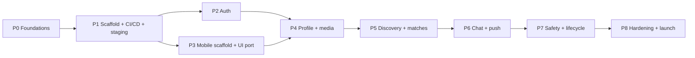

# 09 — Roadmap

Status: Draft v0.1 · Sizing is relative (**S** ≈ days, **M** ≈ 1–2 weeks, **L** ≈ 2+ weeks of focused work), not calendar promises. Mobile milestones live in the mobile repo's roadmap and are sequenced against these phases.

## Strategy to ship sooner

1. **Thin vertical slices.** Every phase ends with something demonstrable end-to-end (API + app), not a layer finished in isolation.
2. **Cut scope before cutting safety.** Block/report, moderation, age gate, deletion are *in*; video, premium, web, verification are *out* ([scope](00-product-and-scope.md)).
3. **Boring tech, managed services.** Spend time on product, not on running databases.
4. **Contract first.** The OpenAPI spec unblocks mobile work in parallel with backend work.
5. **Staging from the first deploy.** CI/CD is built in phase 1 so every later phase ships through the same pipeline.

## Phase map

Arrows mean "depends on". P2 and P3 can run in parallel once P1 is done.

## Phases & exit criteria

### P0 — Foundations (S)
- Create GitHub repos; push these docs; set branch protection
- Accounts: AWS (org + staging/prod), Apple Developer, Google Play, Firebase, Expo/EAS, Sentry, SMS provider (start DLT/registration early if India), domain
- Confirm assumptions A1–A6 in [scope](00-product-and-scope.md)

**Exit:** repos exist and are protected; accounts created; assumptions recorded.

### P1 — Backend scaffold + CI/CD + staging (M)
- Nest project with three entry points, config/validation, logging, error filter, health/ready, Swagger → `openapi.json`
- Docker + compose (Postgres+PostGIS, Redis, Mailpit); Drizzle baseline migration (extensions)
- GitHub Actions: `pr.yml`, `main.yml`; Terraform for staging (network, RDS, Redis, ECS, ALB); first automated deploy
- ADR set accepted

**Exit:** merge to `main` deploys a `/health`-only service to staging via the pipeline; OpenAPI published as an artifact.

### P2 — Auth (M)
- OTP request/verify (rate limits, attempts, cooldown), JWT + rotating refresh, devices, logout, `/me` minimal
- SMS/email provider interfaces + dev fakes; first real SMS provider
- Security tests: OTP brute force, refresh reuse detection

**Exit:** a REST client can sign in on staging; first `v0.1.0` release with `openapi.json`.

### P3 — Mobile scaffold + UI port (L) *(runs in parallel with P2/P4, see mobile roadmap)*
- Expo app, design tokens, ported screens, generated API client wired to auth

**Exit:** sign-in works from the app against staging; EAS preview build installable.

### P4 — Profile, onboarding & media (L)
- Profile/preferences/location endpoints; age gate; photo upload via presigned URLs, processing + moderation worker
- Onboarding screens in the app

**Exit:** a new user can complete onboarding with approved photos on a real device.

### P5 — Discovery, swipes & matches (L)
- Candidate query + Redis deck + refill jobs; swipe write path with advisory-lock match creation and **race test**; matches list; quota
- Swipe deck UI

**Exit:** two test users can match; load test of discovery query at synthetic 100k profiles meets p95 target.

### P6 — Chat & push (L)
- Socket.IO gateway + Redis adapter; message persistence/idempotency; history/gap-fill; read receipts; typing; FCM push (match, message)
- Chat UI, push registration

**Exit:** two phones chat in realtime; offline recipient gets a push; reconnect gap-fill verified.

### P7 — Safety & account lifecycle (M)
- Block, report, unmatch; photo re-moderation on report; pause; delete + data export; moderator SQL/runbook
- Settings screens, report/block UI, legal links

**Exit:** every store-review safety requirement implemented and demoable.

### P8 — Hardening & launch (L)
- Observability (dashboards, alarms, tracing), runbooks, k6 load tests (swipe, deck, sockets), backup restore drill
- Prod environment via Terraform; security review (use the OWASP ASVS L1 checklist); penetration/abuse tests on OTP & swipes
- Store assets, privacy policy/ToS, TestFlight/Play internal → closed beta → staged rollout

**Exit:** prod live; SLOs and alerts active; restore drill passed; beta feedback triaged; store approval.

### Post-launch candidates (not committed)
`flinger-web` (Next.js) · verification (selfie) · premium & payments · image messages · smarter ranking · multilingual · admin console · analytics pipeline · multi-region reads.

## Risk register (top)

| Risk | Likelihood | Impact | Mitigation |
|---|---|---|---|
| India SMS/DLT registration delays OTP | High if India-first | Blocks login | Start in P0; keep email-OTP + Apple/Google fallback |
| Cold start: too few users per radius | High | Poor retention | Soft launch city-by-city; widen-radius logic; waitlist |
| App-store review rejection (UGC/dating) | Medium | Delays launch | Safety features in v1; clear moderation docs; submit TestFlight early |
| Scope creep (video, premium, web) | High | Delays | Scope doc is the gate; additions require an ADR/roadmap change |
| Solo bandwidth | High | Delays | Managed services, thin slices, automation (CI/CD, IaC) |
| Photo moderation false negatives | Medium | Safety/brand | Report flow + re-moderation, human review queue |
| Realtime scaling surprises | Low–Med | Chat degradation | Redis adapter from day one; load test in P8 |

## Tracking

Work is tracked as GitHub Issues + a Project board per repo, one milestone per phase (P1…P8). Each phase's exit criteria above become the milestone's definition of done.
