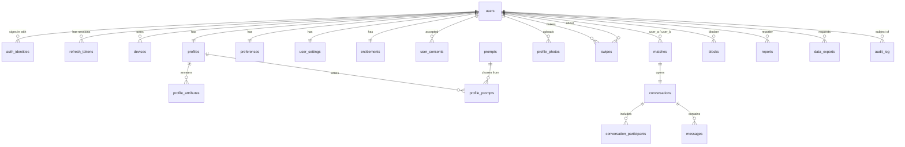

# 13 — API & Schema Reference (planned)

Status: Draft v0.2 · 2026-10-25 · For owner review **before** each feature is built. v0.2: location is GPS-only, `places`, `profile_stats`, recommendation and Bloom filter ([14](14-recommendations-and-bloom-filter.md)), review fixes (section 6).
Legend: ✅ built and tested · 🔨 in progress · ⬜ planned. Feature numbers (F1…F7) are the build order; each feature ships backend + app end to end.

This is the consolidated catalog of **every endpoint, table and data store** we plan for v1. It refines [03 data model](03-data-model.md) and [04 API](04-api-and-contracts.md) with the Hinge-style decisions (likes target a photo or prompt with an optional comment; 25 likes a day; 3 prompts; 4–6 photos). Where this doc and 03/04 differ, **this doc wins** (notably: `likes`/`passes` replace the earlier generic swipe endpoint).

---

## 1. Data stores

| Store | Used for | Notes |
|---|---|---|
| **PostgreSQL 17 + PostGIS** (system of record) | Accounts, profiles, photos metadata, likes, matches, chat, safety | One database `flinger`. Managed (RDS) in UAT/prod. Local: `docker compose`. |
| **Redis 7** | Sign-in codes, rate limits, discovery decks, presence, socket fan-out, (later) job queues | Disposable: flushing it loses nothing that matters. Keys namespaced `flinger:{env}:…` |
| **Object storage (S3)** | Profile photos | Private bucket, served through a CDN. Only metadata lives in Postgres. |
| **External services** | Email (SES/SMTP), SMS (Phase 1), push (FCM), image moderation (Rekognition) | Behind interfaces so vendors can be swapped |

Environments: `local` (Docker), `uat`, `production` — each with its own database, Redis and bucket.

### Redis keys (all carry a TTL unless rebuildable)

| Key | Purpose | TTL |
|---|---|---|
| `otp:code:{idHash}` ✅ | Hashed sign-in code | 10 min |
| `otp:attempts:{idHash}` ✅ | Wrong-guess counter | 10 min |
| `otp:cooldown:{idHash}` ✅ | Resend cooldown | 120 s |
| `rl:{scope}:{id}` ✅ | Rate-limit counters | window |
| `disc:deck:{userId}` ⬜ | Precomputed candidate ids | 24 h |
| `disc:seen:{userId}:{slice}` ⬜ | **Bloom filter** (bitmap) of people already liked, passed or matched; rebuildable from Postgres ([14](14-recommendations-and-bloom-filter.md)) | none |
| `loc:last:{userId}` ⬜ | Last accepted location, for impossible-travel checks | 30 d |
| `likes:count:{userId}:{yyyymmdd}` ⬜ | Daily likes used | 36 h |
| `presence:{userId}` ⬜ | Online heartbeat | 60 s |

---

## 2. Tables

Conventions: `snake_case`, plural; primary keys are UUIDv7 (time-ordered); all timestamps `timestamptz` (UTC); foreign keys cascade on user deletion unless noted.

### Relationship overview

### A. Identity & sessions

| Table | Status | Columns | Constraints / indexes |
|---|---|---|---|
| `users` | ✅ | `id`, `status` (`pending`·`active`·`paused`·`suspended`·`deleted`), `created_at`, `updated_at`, `last_active_at`, `deleted_at` | PK `id` |
| `auth_identities` | ✅ | `id`, `user_id`→users, `provider` (`email`·`phone`·`apple`·`google`), `subject` (email lowercased / phone E.164), `verified_at`, `created_at` | `UNIQUE(provider, subject)` = one account per email and per phone; `UNIQUE(user_id, provider)` |
| `refresh_tokens` | ✅ | `id`, `user_id`, `family_id` (device session), `token_hash` (SHA-256, never the token), `device_id`, `platform`, `expires_at`, `revoked_at`, `replaced_by`, `created_at` | `UNIQUE(token_hash)`; index `family_id`, `user_id`. Reuse of a rotated token revokes the family |
| `devices` ⬜ F4 | | `id`, `user_id`, `device_id` (client-generated), `platform`, `push_token`, `app_version`, `last_seen_at` | `UNIQUE(user_id, device_id)` |
| `user_consents` ✅ F2 | | `id`, `user_id`, `document` (`terms`·`privacy`·`guidelines`), `version`, `accepted_at` | index `(user_id, document)` |

### B. Profile (onboarding answers)

Option ids are stable `snake_case` strings validated against code-side enums (see `profile_mappings` from the Flutter app).

| Table | Status | Columns | Notes |
|---|---|---|---|
| `profiles` ✅ F2 | | `user_id` PK/FK, `display_name` (2–30), `birth_date`, `gender` (`woman`·`man`·`non_binary`), `dating_mode` (default `dating`), `height_cm`, `kids_status`, `family_plans`, `religion`, `politics`, `bio` (≤500, optional), `location geography(Point,4326)` (GPS only, stored at ~100 m precision), `location_accuracy_m`, `location_updated_at`, `place_id`→places (nearest city), `visibility` (`visible`·`hidden`: hidden by moderation; *pausing* is `users.status = paused`), `verification_status` (`none`·`pending`·`verified`), `onboarding_completed_at`, `created_at`, `updated_at` | `CHECK` age ≥ 18 from `birth_date`; **GiST index on `location`**; partial index on `(gender, birth_date)` where visible and onboarding complete. Birthdate is immutable after set |
| `profile_attributes` ✅ F2 | | `user_id`, `kind` (`interested_in`·`hoping_to_find`·`values`·`causes`), `value` | PK `(user_id, kind, value)`; max counts in service (intentions ≤ 2, values ≤ 3, causes ≤ 3) |
| `prompts` ✅ F2 | | `id`, `text`, `category`, `active` | The prompt library (~30 to start), seeded by migration |
| `profile_prompts` ✅ F2 | | `id`, `user_id`, `prompt_id`→prompts, `answer` (≤150), `position` (1–3) | `UNIQUE(user_id, position)`; exactly 3 required to complete onboarding |
| `profile_photos` ✅ F2 | | `id`, `user_id`, `storage_key`, `position` (1–6), `width`, `height`, `moderation_status` (`pending`·`approved`·`rejected`), `rejection_reason`, `created_at` | `UNIQUE(user_id, position)`; 4–6 required; only `approved` shown to others |
| `preferences` ✅ F2 | | `user_id` PK/FK, `min_age` (18–99), `max_age`, `max_distance_km` (1–200), `show_distance`, `expand_radius_when_empty` (default true) | defaults at onboarding; “who I want to meet” is the `interested_in` attributes |
| `user_settings` ⬜ F5 | | `user_id` PK/FK, `read_receipts` (default **false**), `notify_new_matches`, `notify_new_messages`, `locale` | |
| `places` 🔨 F2 (placeholder seed of 66 cities) | | `id`, `geoname_id` UNIQUE, `name`, `display_name` (fixes like Bengaluru), `state`, `population`, `location geography(Point)`, `is_active` | Indian cities and towns, seeded from GeoNames (CC BY 4.0). GiST index; nearest-city lookup when a location is saved. Data source still under review |
| `profile_stats` ⬜ F3 | | `user_id` PK/FK, `impressions_7d`, `likes_received_7d`, `passes_received_7d`, `likes_sent_7d`, `updated_at` | feeds exposure balancing in recommendations |
| `entitlements` ⬜ F3 | | `user_id` PK/FK, `plan` (default `free`), `likes_per_day` (default **25**), `updated_at` | rows optional: missing row = config default. Plans plug in here later |

### C. Discovery, likes & matches

| Table | Status | Columns | Notes |
|---|---|---|---|
| `swipes` ✅ F3 | | `id`, `swiper_id`, `target_id`, `direction` (`like`·`pass`), `item_type` (`photo`·`prompt`, likes only), `item_id` (likes only), `comment` (≤150, optional), `request_id`, `created_at` | `UNIQUE(swiper_id, target_id)` (idempotent); index `(target_id, swiper_id) WHERE direction='like'` powers **Liked You** and match detection. Hash-partition by `swiper_id` when large |
| `matches` ✅ F3 | | `id`, `user_a`, `user_b` (ordered so `user_a < user_b`), `created_at`, `unmatched_at`, `unmatched_by` | `UNIQUE(user_a, user_b)`, `CHECK(user_a < user_b)`; match creation guarded by a pair-level advisory lock (no lost matches on simultaneous likes) |

### D. Chat

| Table | Status | Columns | Notes |
|---|---|---|---|
| `conversations` ⬜ F4 | | `id`, `match_id` UNIQUE→matches, `last_message_id`, `last_message_at`, `created_at`, `closed_at` | one per match |
| `conversation_participants` ⬜ F4 | | `conversation_id`, `user_id`, `last_read_message_id`, `last_read_at` | PK `(conversation_id, user_id)`; drives unread counts and read receipts |
| `messages` ⬜ F4 | | `id` (UUIDv7), `conversation_id`, `sender_id` (SET NULL if the sender deletes their account, so the other person keeps the history), `type` (`text`), `body` (≤2000), `client_msg_id`, `created_at` | `UNIQUE(conversation_id, client_msg_id)` (idempotent send); index `(conversation_id, id DESC)`; **range-partitioned by month** |

### E. Safety & account lifecycle

| Table | Status | Columns | Notes |
|---|---|---|---|
| `blocks` ⬜ F5 | | `blocker_id`, `blocked_id`, `created_at` | PK `(blocker_id, blocked_id)`; effect is mutual (neither sees the other) |
| `reports` ⬜ F5 | | `id`, `reporter_id`, `reported_id`, `target_type` (`user`·`photo`·`prompt`·`message`), `target_id`, `reason`, `details`, `snapshot jsonb`, `status` (`open`·`dismissed`·`actioned`), `resolved_by`, `resolved_at`, `created_at` | message reports keep a snapshot of recent messages |
| `audit_log` ⬜ F5 | | `id`, `actor`, `action`, `subject_user_id`, `meta jsonb`, `created_at` | moderation actions, suspensions, exports, deletions |
| `data_exports` ⬜ F5 | | `id`, `user_id`, `status`, `storage_key`, `expires_at`, `created_at` | “download my data” jobs |

**Not in Postgres:** sign-in codes and attempt counters (Redis), presence and typing (Redis/ephemeral), photo bytes (S3).

---

## 3. API endpoints

Base path `/v1` (health and readiness are at the root). 🔒 = needs `Authorization: Bearer <accessToken>`. All errors are RFC 7807 `problem+json` with a stable `code`. Lists use cursor pagination (`?cursor=&limit=`). Retryable writes accept a client-generated `requestId` so retries never duplicate.

### F1 · Authentication (email now, phone in Phase 1)

| Method & path | Auth | Purpose |
|---|---|---|
| `POST /auth/otp/request` ✅ | public | Send a 6-digit code to an email. Returns resend/expiry seconds. Rate limited |
| `POST /auth/otp/verify` ✅ | public | Check the code; creates the account on first success; returns access + refresh tokens and `isNewUser`. Body includes the device (`id`, `platform`) |
| `POST /auth/refresh` ✅ | public | Swap a refresh token for a new pair (rotation, reuse detection) |
| `POST /auth/logout` ✅ | 🔒 | Sign out this device immediately |
| `POST /auth/logout-all` ⬜ | 🔒 | Sign out every device |
| `GET /me` ✅ | 🔒 | The signed-in account: id, status, email, `onboardingCompleted` |
| Phase 1: `POST /auth/otp/request` with `phone` ⬜ | public | Same flow, SMS delivery |
| Phase 1: `POST /me/identities/{email\|phone}/otp/request` and `/verify` ⬜ | 🔒 | Attach the other identity (one account per phone and per email) |

### F2 · Onboarding & profile

| Method & path | Auth | Purpose |
|---|---|---|
| `GET /me/profile` ✅ | 🔒 | Own profile + onboarding progress (which steps are done, what is next) so the app can resume |
| `PATCH /me/profile` ✅ | 🔒 | Save answers step by step (name, birthdate once, gender, dating mode, height, kids, family plans, religion, politics, bio, interested-in, intentions, values, causes). Under-18 rejected |
| `GET /prompts` ✅ | 🔒 | The prompt library |
| `PUT /me/prompts` ✅ | 🔒 | Set the 3 prompt answers |
| `GET /me/photos` ✅, `POST /me/photos` ✅ | 🔒 | Reserve a photo slot; returns `photoId` and a short-lived upload URL |
| `POST /me/photos/{id}/complete` ✅ | 🔒 | Tell the server the upload finished; starts processing and moderation |
| `PATCH /me/photos/order` ✅ | 🔒 | Reorder (first = main) |
| `DELETE /me/photos/{id}` ✅ | 🔒 | Remove (cannot go below 4) |
| `PUT /me/location` ✅ | 🔒 | Save the **GPS** fix: `latitude`, `longitude`, `accuracyMeters`, `mocked`, `capturedAt`. No manual city. Rejects mock locations (`LOCATION_MOCKED`), outside India (`LOCATION_OUTSIDE_SERVICE_AREA`), very inaccurate fixes, impossible travel (ignored and flagged). Returns the city label |
| `GET /me/preferences`, `PATCH /me/preferences` ✅ | 🔒 | Age range, max distance, show distance |
| `POST /me/profile/complete` ✅ | 🔒 | Finish onboarding: checks every required step (4–6 photos, 3 prompts, all Must answers), activates the account |
| `POST /me/consents` ✅ | 🔒 | Record acceptance of terms, privacy and guidelines |

### F3 · Discovery, likes, matches

| Method & path | Auth | Purpose |
|---|---|---|
| `GET /discovery/deck?limit=` ⬜ | 🔒 | Next batch of cards from the precomputed deck ([14](14-recommendations-and-bloom-filter.md)); includes `radiusKm` used and whether it was widened |
| `GET /profiles/{userId}` ⬜ | 🔒 | One member's full card. Only for people in your deck, your Liked You list or your matches (no browsing arbitrary ids) |
| `POST /likes` ✅ | 🔒 | Like a person via one photo or prompt, with optional comment. Returns `matched`, `matchId`, `likesRemaining`. Enforces 25/day (`LIKE_LIMIT_REACHED`) |
| `POST /passes` ✅ | 🔒 | Pass on a person (rate limited against bots) |
| `GET /me/limits` ✅ | 🔒 | Likes left today and when they reset |
| `GET /likes/received?cursor=` ✅ | 🔒 | “Liked You” list: who liked you, which item, their comment |
| `GET /matches?cursor=` ✅ | 🔒 | Your matches (new ones first) |
| `DELETE /matches/{matchId}` ✅ | 🔒 | Unmatch (closes the chat, hides the pair forever) |

### F4 · Chat & push

| Method & path | Auth | Purpose |
|---|---|---|
| `GET /conversations?cursor=` ⬜ | 🔒 | Chat list: last message, unread count |
| `GET /conversations/{id}/messages?cursor=&after=` ⬜ | 🔒 | History, and gap-fill after a reconnect |
| `POST /conversations/{id}/messages` ⬜ | 🔒 | Send a message over REST (fallback to the socket); idempotent via `clientMsgId` |
| `POST /conversations/{id}/read` ⬜ | 🔒 | Mark read up to a message |
| `PUT /devices/{deviceId}/push-token` ⬜ | 🔒 | Register the push token |
| `DELETE /devices/{deviceId}/push-token` ⬜ | 🔒 | Deregister on logout |
| **Socket.IO `/chat`** ⬜ | 🔒 | Events: `message:send` → `message:ack`, `message:new`, `read`, `typing`, `presence`, `match:new` |

### F5 · Safety, settings & account lifecycle

| Method & path | Auth | Purpose |
|---|---|---|
| `POST /blocks`, `DELETE /blocks/{userId}`, `GET /blocks` ⬜ | 🔒 | Block, unblock, list blocked people |
| `POST /reports` ⬜ | 🔒 | Report a person, photo, prompt or message (optionally also block) |
| `GET /me/settings`, `PATCH /me/settings` ⬜ | 🔒 | Read receipts, notification toggles |
| `POST /me/pause`, `DELETE /me/pause` ⬜ | 🔒 | Hide / unhide my profile |
| `POST /me/export` ⬜, `GET /me/export/{id}` ⬜ | 🔒 | Request and download my data |
| `DELETE /me` ⬜ | 🔒 | Delete my account (needs a typed confirmation) |

### Platform

| Method & path | Auth | Purpose |
|---|---|---|
| `GET /health` ✅ | public | Liveness |
| `GET /ready` ✅ | public | Readiness (Postgres + Redis) |
| `GET /v1/config` ✅ | public | Minimum app version, feature flags, product limits (photos 4–6, 3 prompts, 25 likes/day, message length…) |
| `GET /docs`, `/docs/openapi.json` ✅ | non-production | Interactive API docs and the machine-readable contract |

**Totals:** about 48 HTTP endpoints plus one Socket.IO namespace. **Delivered so far:** 28.

**Built notes (F2a):** `profiles` is created on the first answer; location columns come with the location slice. `GET /me/profile` returns `onboarding: { completed, nextStep, missing }` over the required steps `basics, gender, interested_in, hoping_to_find, height, values, photos, prompts, location, consents`. Optional questions (kids and family, beliefs, causes) are not steps. `GET /v1/config` now includes `legalVersion`.

**Built notes (F2c photos):** `profile_photos.status` is `uploading → pending → approved | rejected` (the doc's `moderation_status`). Upload = reserve (`POST /me/photos`, returns a 10-minute presigned PUT with a signed `Content-Type`) → device PUTs the bytes → `complete` checks the object exists, is ≤ 10 MB and really is the declared image type (magic bytes), else deletes it. Reservations not completed within 30 min are released on the next reservation. Download URLs are presigned for 1 hour (CDN later). `GET /me/profile` includes `photos`; 4 photos that are `pending` or `approved` complete the photos step. Locally: SeaweedFS (S3 API on :8333) and `PHOTO_MODERATION=auto_approve`.

**Built notes (F2d location):** `PUT /me/location` refuses mocked fixes, points outside a rough India box, accuracy worse than 10 km and fixes older than 10 minutes (each with its own `LOCATION_*` code). A jump faster than 1000 km/h over more than 50 km is ignored (`accepted: false`, old city kept) and `profiles.location_flagged_at` set. Stored rounded to 3 decimals (~100 m); the label is the nearest active `places` row within 75 km. Responses carry only the city and state, never coordinates. 60 updates/hour.

**Built notes (F2e):** `POST /me/profile/complete` returns 409 `ONBOARDING_INCOMPLETE` with the missing steps in `errors[].path`; otherwise sets `onboarding_completed_at`, creates default preferences (own age ±5, at least a 10-year window, 50 km, show distance, widen when empty) and moves the account `pending → active`. `GET /me` `onboardingCompleted` is `status != pending`.

**Built notes (F3a):** one `swipes` row per pair (unique, so likes and passes are idempotent; a like after a pass is 409 `ALREADY_PASSED`). Likes point at an approved photo or a prompt answer (`profile_prompts.id`, now exposed as `prompts[].id`), else 422 `LIKE_ITEM_INVALID`. Daily likes are a Redis counter per 04:00-IST window (`likes:count:{user}:{window}`), 429 `LIKE_LIMIT_REACHED` with `Retry-After`; retries are not charged. Matches are created under a pair advisory lock (`pg_advisory_xact_lock`), so simultaneous likes make exactly one. The seen filter (Bloom, Redis bitmaps keyed by seed) is fed on every like/pass and rebuilt from Postgres when missing. Lists use keyset cursors on `(created_at, id)`.

---

## 6. Review fixes in v0.2

| # | Gap found | Fix |
|---|---|---|
| 1 | Location could be typed in manually | GPS only; anti-spoofing checks; `places` for the city label |
| 2 | No data for fair ranking | `profile_stats` counters; exposure balancing in scoring |
| 3 | "Paused" in two places (`users.status` and `profiles.visibility`) | Pause = `users.status`; `visibility` is only for moderation |
| 4 | Deleting an account would delete the other person's chat history | `messages.sender_id` set to null instead |
| 5 | `GET /profiles/{id}` allowed scraping any member | Only people already in your deck, likes or matches |
| 6 | Sparse cities could show an empty deck | Radius widens in steps; preference to opt out |
| 7 | Seen-check against thousands of swipes per refill | Per-user Bloom filter in Redis; Postgres stays the truth |

Tables now: **23** (3 built). Endpoints: **~48** (8 built).

---

## 4. Build order (feature by feature, end to end)

| # | Feature | Backend | App screens | Status |
|---|---|---|---|---|
| F1 | **Email sign-in** | auth + users, OTP, JWT/refresh | Landing → email → code | ✅ |
| F2 | **Onboarding & profile** | profile, photos, prompts, preferences | 13-step onboarding, edit profile | ✅ onboarding end to end · Edit profile comes with the Profile tab |
| F3 | **Discover, likes, matches** | discovery, likes/passes, matches | Discover, like sheet, match, Liked You | 🔨 3a likes/passes/matches/limits/Liked You backend ✅ |
| F4 | **Chat & push** | conversations, messages, socket, devices | Chats, conversation, notifications primer | ⬜ |
| F5 | **Safety & account** | blocks, reports, settings, delete/export | Report/block, settings, delete | ⬜ |
| F6 | **Phone sign-in (Phase 1)** | SMS provider, phone identity | Phone tab goes live | ⬜ |

After each feature: tested locally with real Postgres and Redis; infra and deployment come after the app works end to end.

## 5. Open points for you

1. **Passes:** do we store them forever, or expire them after ~30 days so people can reappear? (Default: store forever.)
2. **Likes per day** resets at a fixed time (assumed 04:00 IST) rather than 24 h after the first like. OK?
3. **Reports** are reviewed by you in a queue (SQL for now). Fine for launch?
4. **Distance** shown as rounded km buckets, never coordinates. Any other privacy preference (hide city)?
