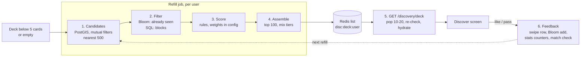

# 14 — Recommendations (the Discover deck) and the "seen" Bloom filter

Status: Draft v0.1 · 2026-10-25 · Builds on [06](06-discovery-matching-chat.md); tables and endpoints in [13](13-api-and-schema-reference.md).

## 1. The pipeline at a glance

Postgres is the source of truth. Redis holds only the precomputed deck and the Bloom filters, and both can be rebuilt.

## 2. Step by step

### Step 1: Candidate generation (Postgres + PostGIS)

One indexed query per refill. A candidate must be:
- active, onboarding complete, visible, with at least one approved photo, same `dating_mode`
- within **my** radius and I within **theirs** (each person's max distance applies)
- in **my** age range and I in **theirs**; gender wanted **both ways**

`ORDER BY location <-> my_point LIMIT 500` uses the GiST index to take the nearest 500 first (KNN), so the query stays fast however many members a city has.

**Sparse areas (no city gating):** if fewer than ~50 candidates come back, the radius widens in steps (25 → 50 → 100 → 200 km). It only goes beyond the person's own maximum if they leave "Show people further away when I run out" on (default on), and the app then says "Showing people within 100 km".

### Step 2: Filtering

| Exclude | How | Why that way |
|---|---|---|
| Already liked, passed, matched | **Bloom filter** (below) | Thousands of ids per active user; checking them in Redis is far cheaper than a big `NOT IN` |
| Blocked / blocking, reported | SQL on the shortlist | Safety must be exact. A Bloom filter can't forget (unblock) and can be wrong in one direction, so safety never relies on it |
| Already in my deck | Redis list | Avoid duplicates |

### Step 3: Scoring (v1: transparent rules, no machine learning)

`score = Σ weightᵢ × signalᵢ + small random jitter`. Weights live in config so they can be tuned without a release.

| Signal | Meaning | Data |
|---|---|---|
| Activity | Recently active people answer; decays over days | `users.last_active_at` |
| Distance | Closer is better (log decay) | PostGIS distance |
| Compatibility | Overlap in **intentions** (strongest), values, causes; kids/family-plans and religion fit when both answered | `profile_attributes`, `profiles` |
| Profile quality | Approved photos, 3 prompts, bio | photos, prompts |
| Reciprocity | They already liked me: high chance of a match | `swipes` |
| New-member boost | First ~72 h get extra exposure so new people see likes early | `users.created_at` |
| Exposure balance | Penalise people shown a lot recently, so likes are not concentrated on a few profiles | `profile_stats.impressions_7d`, `likes_received_7d` |

### Step 4: Assembly
Take the top ~100, mix them in tiers instead of a strict sort (variety), push the ids to `disc:deck:{userId}` (24 h TTL).

### Step 5: Serving
`GET /discovery/deck` pops 10–20 ids, **re-checks** each one (still active and visible, not blocked since), loads fresh profile data and photos, records impressions, and returns the cards. If the list is empty it runs a small synchronous refill so the screen is never blank because of timing.

### Step 6: Feedback
A like or pass writes the `swipes` row (idempotent), adds the target to my Bloom filter, bumps `profile_stats` counters, and checks for a match (pair-level advisory lock, see [06](06-discovery-matching-chat.md)). Those counters feed the next refill's scoring.

### Later (not v1)
Learn the weights from outcomes (like-back and reply rates), "people who liked X also liked Y" (collaborative filtering), a daily **Most Compatible** pick, and **We Met** feedback.

## 3. The Bloom filter

### What it does
One filter per user answers "has this user already seen person X?".
- **Never a false "no":** anyone you have liked, passed or matched is always excluded. You will never see them again by accident.
- **Rarely a false "yes":** about 1 in 100 people you have never seen may be skipped. They still show up for everyone else, and the filter is rebuilt periodically with a new random seed, so who gets skipped changes over time.

### Implementation choice
We implement the filter ourselves on a plain Redis bitmap (`SETBIT` / `GETBIT`, k hash positions from a seeded hash of the user id). It works on any Redis or Valkey, locally and in the cloud, with no extra module. The `SeenFilter` interface allows a switch to a native Bloom module later if the managed Redis offers one.

### Sizing (1% false-positive rate)
Bits needed ≈ 9.6 × items; 7 hash functions.

| History | Size per user |
|---|---|
| 1,000 seen | ~1.2 KB |
| 10,000 seen | ~12 KB |

The filter is **scalable**: it starts sized for 1,000 and adds a larger slice when full, so memory follows real activity. Example: 100,000 users averaging 500 swipes ≈ 60 MB of Redis.

### Rules
1. Postgres `swipes`, `matches` and `blocks` remain the truth. If Redis loses a filter, it is rebuilt from them on first use.
2. A rebuild job runs when needed (unblock, a pass-expiry policy, a seed rotation) because Bloom filters cannot remove items.
3. Safety checks (blocks, reports, suspended accounts) are always exact SQL, never the Bloom filter.

## 4. Data this needs (added to the schema in 13)
- `profile_stats` (user_id, impressions_7d, likes_received_7d, passes_received_7d, likes_sent_7d, updated_at): counters for exposure balance, refreshed by the worker.
- `preferences.expand_radius_when_empty` (default true).
- Redis: `disc:deck:{userId}`, `disc:seen:{userId}:{slice}` (bitmaps), `disc:seen-meta:{userId}` (seed, slice sizes).

## 5. Performance targets
Deck response p95 < 400 ms from a ready list; refill query < 200 ms at 100k profiles in a city. Both are load-tested before launch ([09 roadmap](09-roadmap.md), P8).
